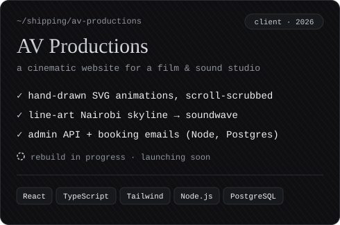
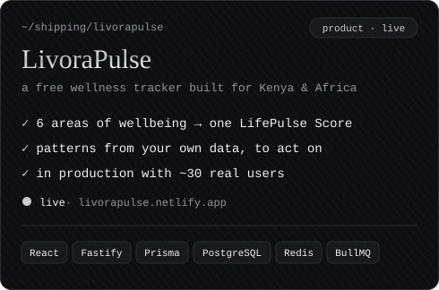
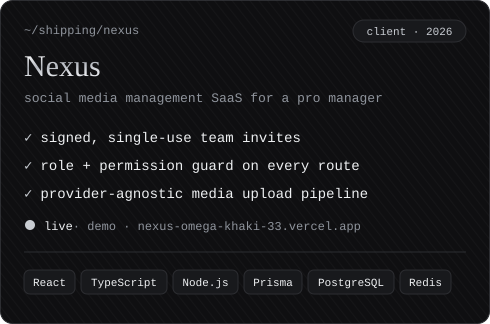
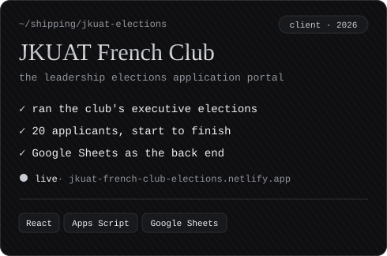
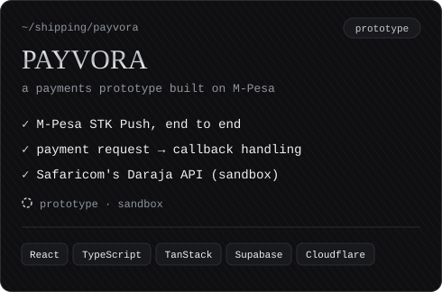
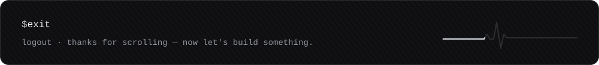

<div align="center">

<a href="https://portfolio-xi-eight-dpx6txtrm7.vercel.app/">
  
</a>

</div>

<br/>

### `01` &nbsp; the short version

Full-stack developer in **Nairobi** who builds and ships web apps with **React, TypeScript, Node.js and PostgreSQL** — from the first design to a live deployment, for clients and real users. I also work in **AI training**: rating and reviewing AI outputs for accuracy and safety, and designing tasks for AI agents.

Studying **Mathematics & Computer Science at JKUAT**. Native Kiswahili speaker, fluent in English, getting there in French.

How I work, as a diff:

```diff
+ ship something a little rough
- polish something that never leaves my laptop
+ write code that's easy to come back to six months later
- over-engineer things that don't need it yet
```

<br/>

### `02` &nbsp; shipped

<table>
<tr>
<td width="50%" valign="top">
<a href="https://portfolio-xi-eight-dpx6txtrm7.vercel.app/work/av-productions"></a>
<p align="center"><a href="https://portfolio-xi-eight-dpx6txtrm7.vercel.app/work/av-productions">case study</a> · <a href="https://github.com/donnycee-rgb/av-web">code</a></p>
</td>
<td width="50%" valign="top">
<a href="https://portfolio-xi-eight-dpx6txtrm7.vercel.app/work/livorapulse"></a>
<p align="center"><a href="https://livorapulse.netlify.app">live</a> · <a href="https://github.com/donnycee-rgb/livorapulse">frontend</a> · <a href="https://github.com/donnycee-rgb/livorapulse_backend">backend</a></p>
</td>
</tr>
<tr>
<td width="50%" valign="top">
<a href="https://portfolio-xi-eight-dpx6txtrm7.vercel.app/work/nexus"></a>
<p align="center"><a href="https://nexus-omega-khaki-33.vercel.app">demo</a> · <a href="https://github.com/donnycee-rgb/nexus">frontend</a> · <a href="https://github.com/donnycee-rgb/nexusbackend">backend</a></p>
</td>
<td width="50%" valign="top">
<a href="https://portfolio-xi-eight-dpx6txtrm7.vercel.app/work/jkuat-french-club"></a>
<p align="center"><a href="https://jkuat-french-club-elections.netlify.app">live</a> · <a href="https://github.com/donnycee-rgb/jkuatelectionsportal">code</a></p>
</td>
</tr>
<tr>
<td width="50%" valign="top">
<a href="https://portfolio-xi-eight-dpx6txtrm7.vercel.app/work/payvora"></a>
<p align="center"><a href="https://portfolio-xi-eight-dpx6txtrm7.vercel.app/work/payvora">case study</a></p>
</td>
<td width="50%" valign="middle" align="center">
<a href="https://portfolio-xi-eight-dpx6txtrm7.vercel.app/work"><b>see every project →</b></a><br/>
<sub>screens, stacks and the story behind each one</sub>
</td>
</tr>
</table>

<details>
<summary><b>more on each →</b></summary>
<br/>

**AV Productions** — the old site was wordy and hard to navigate, so I restructured it into one that tells the whole story as you scroll, with a cinematic identity built around film and sound: hand-drawn SVG animations, a line-art Nairobi skyline that turns into a soundwave, and a fill-in-the-script booking form. A Node.js + PostgreSQL back end runs the owner's admin and booking emails.

**LivoraPulse** brings six areas of wellbeing — physical activity, nutrition, screen time, focus, mood and eco habits — into one daily **LifePulse Score**, and shows people patterns in their own data they can act on ("on days you sleep 7+ hours, your mood is higher"). I designed and built it end to end and run it in production — including the unglamorous part: failing migrations, missing build files and server cold starts.

**Nexus** is built for a client who manages social accounts professionally: workspaces and teams, invite links that are cryptographically signed and single-use, role and permission checks on every route (plus a `usePermission()` hook that hides what a user can't do), and a media upload pipeline that can switch storage providers without code changes.

**JKUAT French Club** needed its executive elections online: members read about each position and the process, then apply — with Google Sheets as the back end, so the club runs it without a database. 20 applicants went through it.

**PAYVORA** wires Safaricom's M-Pesa STK Push (Daraja API) end to end in the sandbox: the payment request goes to the customer's phone, and the callback confirms the result.

</details>

<br/>

### `03` &nbsp; toolbox

| | |
|:--|:--|
| **frontend** |  |
| **backend** |  &nbsp;<sub>+ Fastify · BullMQ · REST APIs</sub> |
| **data & hosting** |  &nbsp;<sub>+ Railway · Render</sub> |
| **also** |  &nbsp;<sub>+ SQL · AI output evaluation · data annotation</sub> |
| **speaks** | Kiswahili <sub>(native)</sub> · English <sub>(fluent)</sub> · French <sub>(intermediate)</sub> |

<br/>

### `04` &nbsp; the log so far

```console
$ git log --reverse --format="%as  %s"
2025-xx  LivoraPulse — designed, built, shipped, still running
2026-05  freelance full-stack developer — Nexus (client)
2026-xx  JKUAT French Club — elections portal, 20 applicants
2026-08  AI training contractor — remote
2026-09  web developer — AV Productions (client)
   done  Samsung Innovation Campus — programme completed ✓
    now  BSc Mathematics & Computer Science — JKUAT
```

<br/>

### `05` &nbsp; commit log

<div align="center">


</div>

<br/>

### `06` &nbsp; say hi

Taking on freelance and contract work now — websites, web apps and fixes for ones that are stuck — and open to full-time roles once I'm done with school.

<p>
<a href="https://portfolio-xi-eight-dpx6txtrm7.vercel.app/"></a>
<a href="https://portfolio-xi-eight-dpx6txtrm7.vercel.app/contact"></a>
<a href="https://www.linkedin.com/in/dennis-mwendia-90b28331a/"></a>
<a href="mailto:dmwendia30@gmail.com"></a>
</p>


