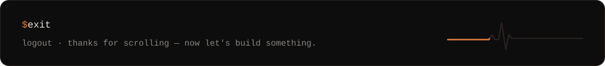

<div align="center">

<a href="https://unrivaled-pony-e15d4c.netlify.app/">
  
</a>

</div>

<br/>

### `01` &nbsp; the short version

Maths & Computer Science student at **JKUAT**, currently in the **Samsung Innovation Campus** program. I build things end to end — backend architecture, database schemas, and the frontend that sits on top — and I like finishing what I start.

How I work, as a diff:

```diff
+ ship something a little rough
- polish something that never leaves my laptop
+ write code that's easy to come back to six months later
- over-engineer things that don't need it yet
```

<br/>

### `02` &nbsp; currently shipping

<table>
<tr>
<td width="50%" valign="top">
<a href="https://github.com/donnycee-rgb/nexus"></a>
<p align="center">
<a href="https://github.com/donnycee-rgb/nexus">frontend</a> · <a href="https://github.com/donnycee-rgb/nexusbackend">backend</a>
</p>
</td>
<td width="50%" valign="top">
<a href="https://github.com/donnycee-rgb/livorapulse"></a>
<p align="center">
<a href="https://github.com/donnycee-rgb/livorapulse">frontend</a> · <a href="https://github.com/donnycee-rgb/livorapulse_backend">backend</a>
</p>
</td>
</tr>
</table>

<details>
<summary><b>more on each →</b></summary>
<br/>

**Nexus** is built for a client who manages social accounts professionally. I built the workspace and team system from the ground up: invite links that are cryptographically signed and single-use, role and permission middleware guarding every route, and a media upload pipeline with a storage adapter that isn't locked to one provider. Instagram OAuth is next.

**LivoraPulse** started as a general wellness platform and is being rebuilt into a burnout-intelligence system for Kenyan university students — repositioned around an admin dashboard institutions can actually pay for, plus a peer-accountability feature called **Wellness Circles**. I'm building toward an application to **AfyaVentures 2026**, AMREF's health-innovation residency.

</details>

<br/>

### `03` &nbsp; toolbox

| | |
|:--|:--|
| **frontend** |  |
| **backend** |  |
| **data & tools** |  |

<br/>

### `04` &nbsp; commit log

<div align="center">


</div>

<br/>

### `05` &nbsp; say hi

Taking on freelance and contract work now, and open to full-time roles once I'm done with school.

<p>
<a href="https://www.linkedin.com/in/dennis-mwendia-90b28331a/"></a>
<a href="mailto:dmwendia30@gmail.com"></a>
<a href="https://unrivaled-pony-e15d4c.netlify.app/"></a>
</p>


